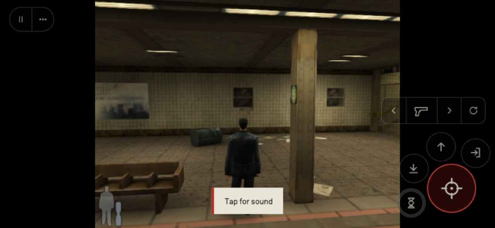
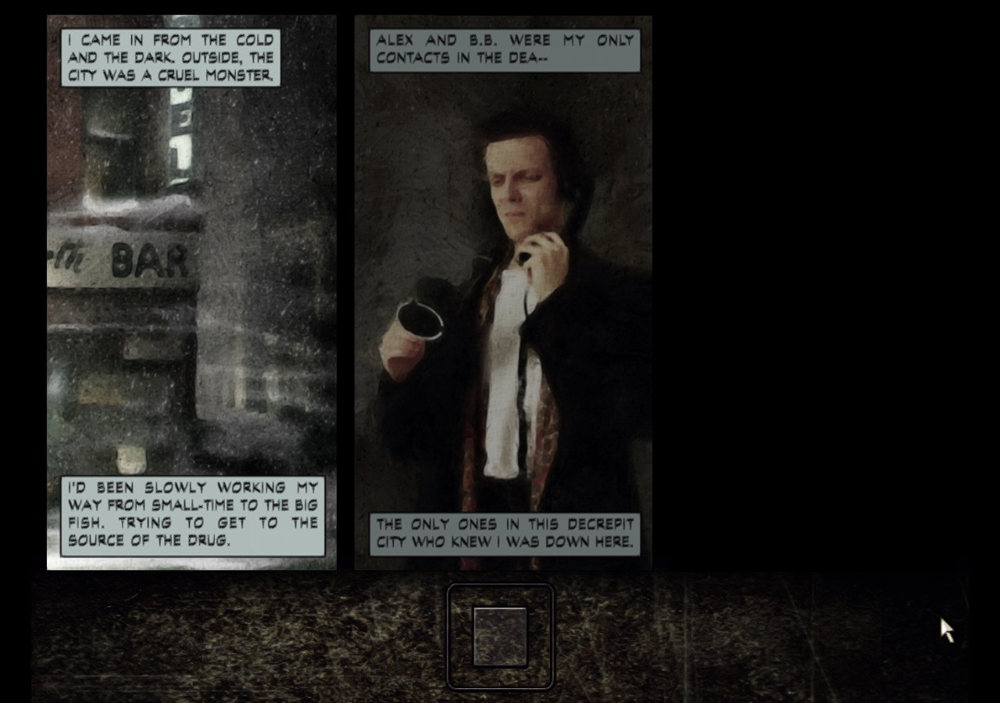

# Max Payne in the browser

Max Payne (PC, 2001, v1.05) running in Chrome and Safari, on desktop and phone — no x86 emulator. All **10 PE binaries** (`MaxPayne.exe`, 5 Remedy MAX-FX engine DLLs, and 4 Visual C++ 6.0 runtime DLLs — **68,234 functions total, 0 failed**) are statically recompiled from x86/x87/MMX to C and compiled to a **14.5 MB Brotli-11 WebAssembly** module (`maxpayne.wasm.br`). `host/` (12,936 LoC C) and `web/` (7,848 LoC JS/HTML) stand in for Windows, Direct3D 8, DirectInput 8, and DirectSound 8.

- **Live:** [maxpayne.cc](https://maxpayne.cc)
- **Technical write-up:** [Max Payne in a browser tab](https://angelmiranda.dev/updates/max-payne-in-the-browser/)
- **Post-ship audit:** [Forensic Reconciliation Book](docs/forensic_reconciliation_book.md) ([web edition](https://angelmiranda.dev/updates/max-payne-reconciliations/))



| Launcher: chapters | Desktop: a comic page |
|---|---|
|  |  |

## Architecture

```text
10 PE binaries (MaxPayne.exe + 5 MAX-FX DLLs + 4 VC++ 6.0 DLLs)
      |
      v  tools/recomp/images.py + frontend.py     rebase below 0x11000000, IAT link, CFG
      |
      v  tools/recomp/lift.py (2,405 LoC Python)  x86 / x87 / MMX -> C chunks
      |
      v  build/gen/*.c + host/*.c (12,936 LoC C)  Win32, D3D8, SM1->WGSL, DSound, DInput
      |
      v  Emscripten (-pthread, Brotli-11)         maxpayne.wasm.br (14.5 MB)
      |
      v  web/*.js (7,848 LoC JS/HTML)             WebGPU, AudioWorklet, OPFS Worker, Touch
```

### Statically recompiled binaries (`census/lift_report.json`)

| PE Image | Rebased Base | Role | Lifted Functions |
|---|---|---|---:|
| `MaxPayne.exe` | `0x00400000` | Game logic, AI, levels, comics, menus, UI | 45,048 |
| `MFC42.DLL` | `0x10600000` | VC++ 6.0 MFC runtime | 10,439 |
| `MSVCP60.DLL` | `0x10900000` | VC++ 6.0 C++ STL runtime | 3,453 |
| `e2mfc.dll` | `0x10100000` | MAX-FX scene graph, portals, camera, sprites | 2,780 |
| `e2_d3d8_driver_mfc.dll` | `0x10400000` | Direct3D 8 render driver plugin + D3DX | 1,897 |
| `rlmfc.dll` | `0x10000000` | Remedy math, memory, RAS archive I/O | 1,653 |
| `MSVCRT.DLL` | `0x10800000` | C runtime (`_ftol`, `longjmp`, math, strings) | 1,411 |
| `MSVCIRT.DLL` | `0x10a00000` | Legacy iostream runtime | 577 |
| `sndmfc.dll` | `0x10300000` | 3D sound engine, voices, music streaming | 566 |
| `grphmfc.dll` | `0x10200000` | Textures, `G_Image`, embedded libjpeg 6a | 410 |
| **Total** | | **0 failed functions** | **68,234** |

## Key engineering highlights

- **Unicorn differential oracle (`tools/recomp/difftest.py`):** 2,000 lifted functions / **7,940 cases** verified against Unicorn with **0 crashes** (`gate: "pass"`, 1,995/1,996 exact match), plus `host/difftrace.c` for instruction-by-instruction live call diffs and Intel SDM Table 4-7 x87 NaN propagation in `host/rt.h`.
- **Direct3D 8 & Shader Model 1.x → WGSL (`host/d3d8.c`, `host/ffp.c`, `host/sm1.c`):** full D3D8 fixed-function pipeline plus a Shader Model 1.1–1.4 bytecode decoder, WGSL compiler, and CPU reference interpreter.
- **Lock-free DirectSound → AudioWorklet (`host/dsound.c`, `web/audio.js`):** C mixer thread with 4-tap Hermite interpolation feeding a `SharedArrayBuffer` ring buffer, plus a linear resampler in the `AudioWorkletProcessor` for 48 kHz iOS Safari and Bluetooth outputs.
- **Two-source patch discipline (`tools/recomp/patches.py`):** only 10 byte patches across all 10 binaries (original bytes asserted before every build), 4 Hor+ widescreen mid-hooks (`host/widescreen.c`, scaling both camera tangents and portal culling frustums), and 15 `RN_FASTCHECK`-verified native hot paths (`host/fast.c`).
- **Phone light version & cold-load pipeline (`web/opfs.js`, `host/files.c`, `tools/build_public.py`):** phones automatically skip the 1 GB HD texture pack and run original 2001 retail textures (`38 s → 5 s` local load, 640 MB budget, 30 fps cap). With 4-thread level-hint prefetch and 1 MB immutable gzip pieces (`game-z/<sha256>.gz`), cold `part1_level1` loads at 80 ms RTT / 50 Mbit dropped from **94.1 s → 27 s** (desktop) and **75.3 s → 24 s** (phone).
- **Safari-safe OPFS saves (`web/opfs.js`):** all saves and registry writes run through a dedicated Worker using `createSyncAccessHandle()` with atomic replacement.

## Repository map

- `tools/recomp/`: static recompiler (`images.py`, `frontend.py`, `lift.py`, `build.py`, `patches.py`) and Unicorn oracle (`difftest.py`).
- `host/`: C runtime replacing Win32, D3D8, SM1→WGSL, DInput8, DSound8, pthreads, RAS/OPFS I/O, widescreen hooks, and `RN_FASTCHECK` fast paths.
- `web/`: browser frontend (launcher, WebGPU backend, AudioWorklet, OPFS Worker, touch HUD, telemetry).
- `rea/map/`: reverse engineering notes per subsystem (addresses and decisions).
- `docs/hosting.md`: Cloudflare R2 static hosting contract (`COOP`/`COEP`/`CORP`).
- `docs/forensic_reconciliation_book.md`: 5-layer, 4-wave post-ship forensic audit (89 named findings, 36 files).

## What is not here

No game files. The build reads the binaries and data from your own copy of Max Payne (PC, 2001, v1.05); nothing from the game install is in this repository.

## Build

```bash
.venv/bin/python tools/recomp/images.py <game dir>
.venv/bin/python tools/recomp/frontend.py
.venv/bin/python tools/recomp/build.py native   # bench build
.venv/bin/python tools/recomp/build.py web      # browser build (needs emsdk; RN_BR=11 for release)
python3 tools/serve.py <game dir> 5181
```

## Notice

A fan project for research and preservation. Not affiliated with or endorsed by Remedy Entertainment, Rockstar Games or Take-Two Interactive. Max Payne is their trademark. See `web/notice.html`.
