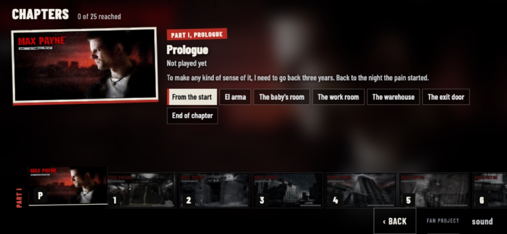

# Max Payne in the browser

Max Payne (PC, 2001, v1.05) running in Chrome and Safari, on desktop and phone. The original `MaxPayne.exe` and its DLLs
are statically recompiled from x86 to C and then to WebAssembly; `host/` and `web/` stand in for Windows, Direct3D 8,
DirectInput and DirectSound.


| Launcher: chapters | Desktop: a comic page |
|---|---|
|  |  |

## What is here
- `tools/recomp/`: the recompiler (x86 to C: `lift.py`, `build.py`, `patches.py`) and its whole-function check against Unicorn (`difftest.py`).
- `host/`: the C runtime that replaces Win32, D3D8, DInput and DSound.
- `web/`: the page: launcher, WebGPU renderer, audio, input, touch controls, saves in the browser (OPFS).
- `rea/map/`: reverse engineering notes per subsystem (addresses and decisions).
- `docs/hosting.md`: how the public package is served (static files on Cloudflare R2 with COOP/COEP headers).

## What is not here
No game files. The build reads the binaries and data from your own copy of the game; nothing from the game install is
in this repository.

## Build
```
.venv/bin/python tools/recomp/images.py
.venv/bin/python tools/recomp/frontend.py
.venv/bin/python tools/recomp/build.py native   # bench build
.venv/bin/python tools/recomp/build.py web      # browser build, needs emsdk
python3 tools/serve.py <game dir> 5181
```

## Notice
A fan project for research and preservation. Not affiliated with or endorsed by Remedy Entertainment, Rockstar Games or
Take-Two Interactive. Max Payne is their trademark. See `web/notice.html`.
